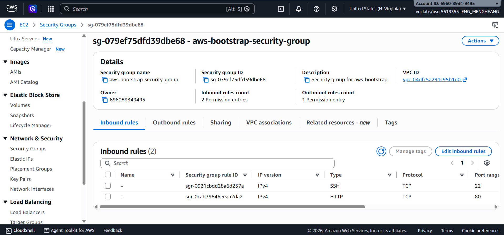
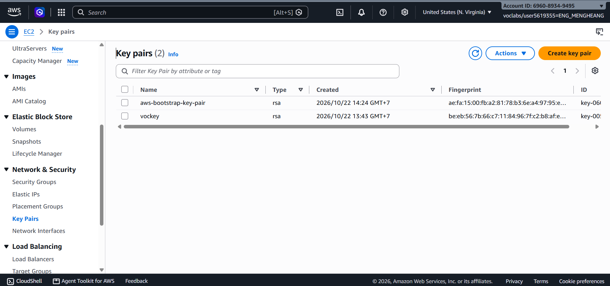
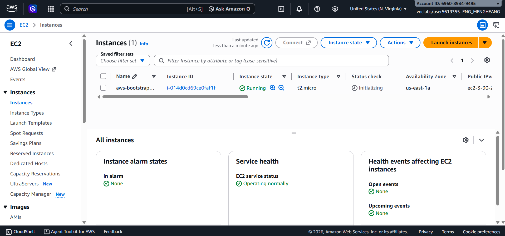
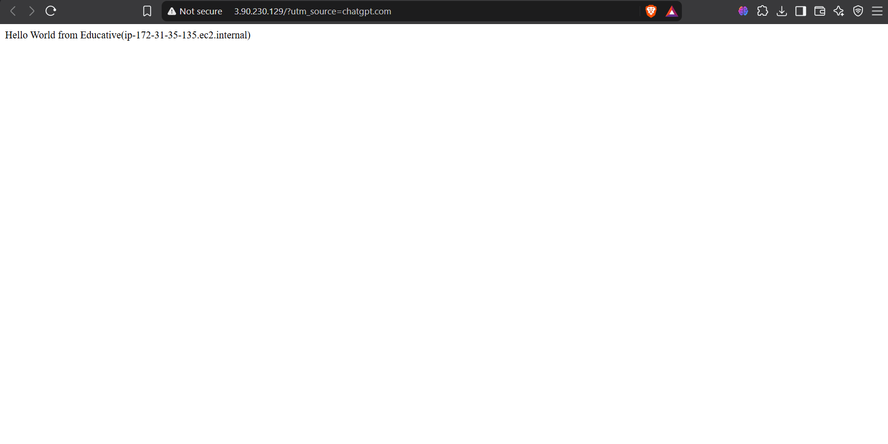
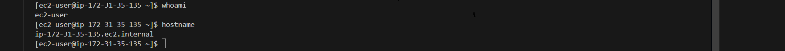
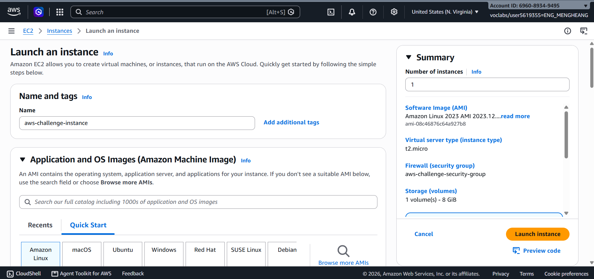
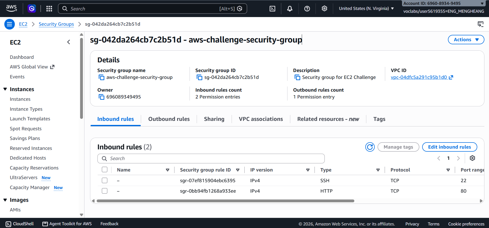
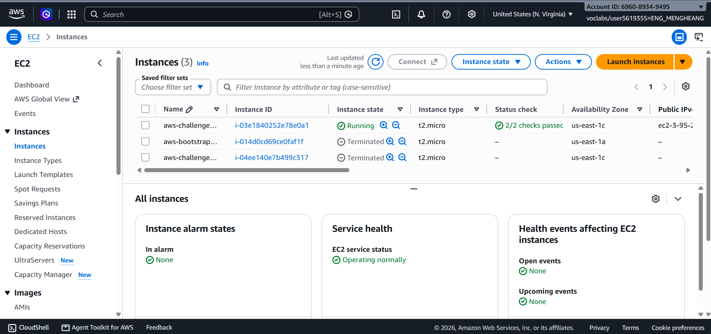
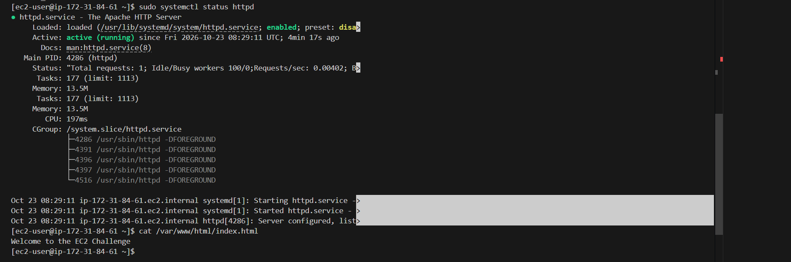
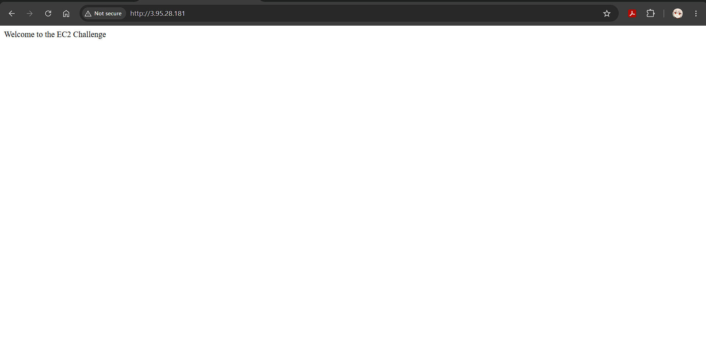

# Cloud Lab 1 Submission — Amazon EC2

Copy this template to `cc-lab-e20220892/lab1/README.md` in your own repository. Follow [the instructions](lab1-instruction.md). Put your screenshots in `lab1/images/` with the file names below.

- **Student name: Eng Mengheang**
- **Student ID: e20220892**
- **Learner Lab user name: voclabs/user5619355=ENG_MENGHEANG**
- **Date completed: 23/10/2026**

---

## Part 1.1 — An Amazon EC2 Walkthrough

### Security group



### Key pair



### Instance details



### Browser test



### SSH connection



I connected using my own SSH client, Git Bash.

---

## Part 1.2 — EC2 Web Solution (Challenge)

### Launch configuration



### Security group



### Running instance



### Commands on the instance



Paste the commands you ran to install the web server and create `index.html`:

    ```bash
    sudo dnf update -y
    sudo dnf install httpd -y
    sudo systemctl enable --now httpd
    echo "Welcome to the EC2 Challenge" | sudo tee /var/www/html/index.html
    cat /var/www/html/index.html
    ```

### Browser test



---

## Questions

1. Your security group has an SSH rule and an HTTP rule. What does each one let you do? What would stop working if you deleted the HTTP rule?
-> The SSH rule on port 22 lets me connect to the EC2 instance remotely using a terminal. The HTTP rule on port 80 lets people open the website in a browser. If I delete the HTTP rule, the website cannot be accessed through HTTP from outside the instance.

2. In Part 1.1 you never logged in to install the web server. What installed it, and when did it run?
-> The user data script installed Apache automatically when the EC2 instance started.

3. Why does the web page open with `http://` but not with `https://`?
-> The page opens with http:// because the server uses HTTP on port 80. It does not open with https:// because HTTPS was not configured.

4. Part 1.2 asked for a 10 GiB root volume. Where in the launch settings did you set it, and how can you check the size on the running instance?
-> I set the root volume to 10 GiB in the Storage section when launching the instance. I can check the size by selecting the instance in EC2, opening the Storage tab, and checking the root volume size.

## Problems and how I solved them (optional)
-> At first, the website did not open. I checked the Apache service and tested it in the terminal. After that, I used the EC2 public DNS address to access the website successfully.

## AI note (optional)

An AI tool suggested checking the Apache service with systemctl status httpd. I checked the command in my EC2 terminal and confirmed that Apache was running.

## Clean up

- [Yes] Part 1.1: instance terminated, key pair and security group deleted.
- [Yes] Part 1.2: instance terminated, security group (and key pair, if any) deleted.