# Cloud Lab 2 Submission — Load Balancer and Auto Scaling

Copy this template to `cc-lab-YOUR_ID/lab2/README.md` in your own repository. Follow [the instructions](lab2-instruction.md). Put your screenshots in `lab2/images/` with the file names below.

- **Student name: ENG Mengheang**
- **Student ID: e20220892**
- **Learner Lab user name: voclabs/user5619355=ENG_MENGHEANG**
- **Date completed: 05/11/2026**

---

## Security groups

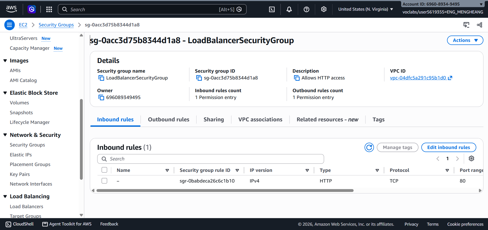

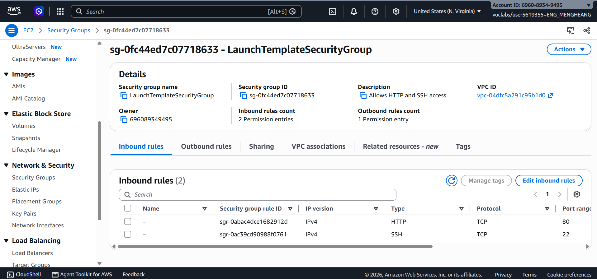

## Target group

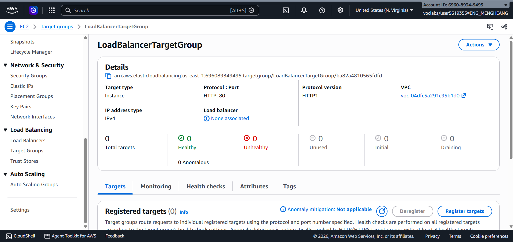

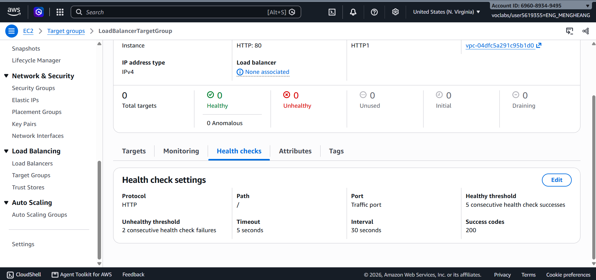

## Application Load Balancer

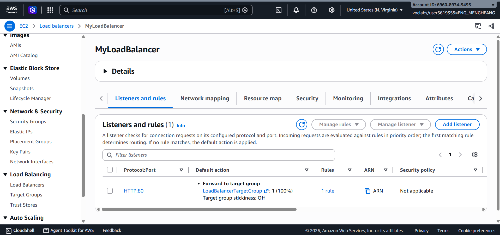

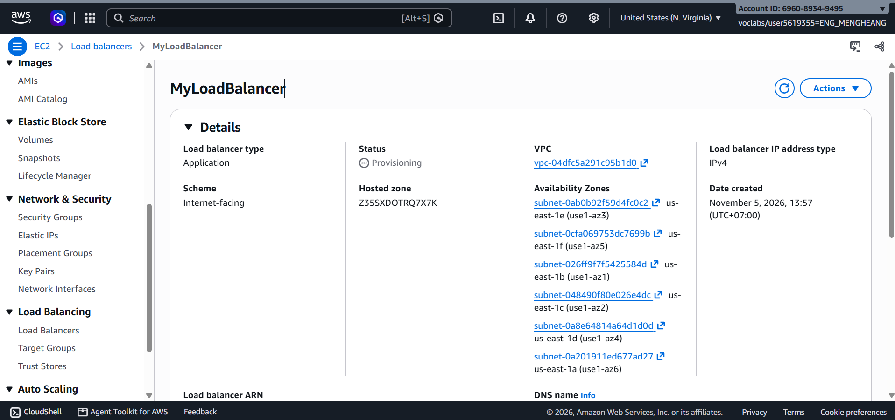

## Launch template

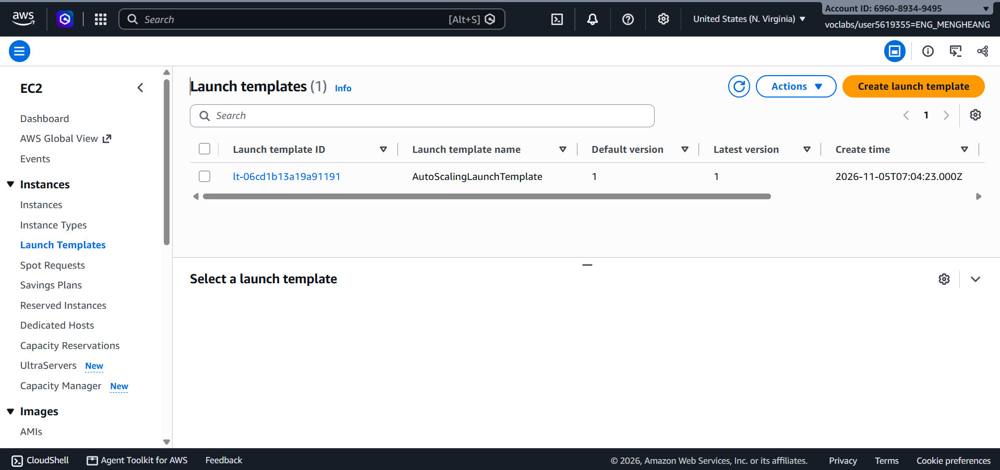

## Auto Scaling group

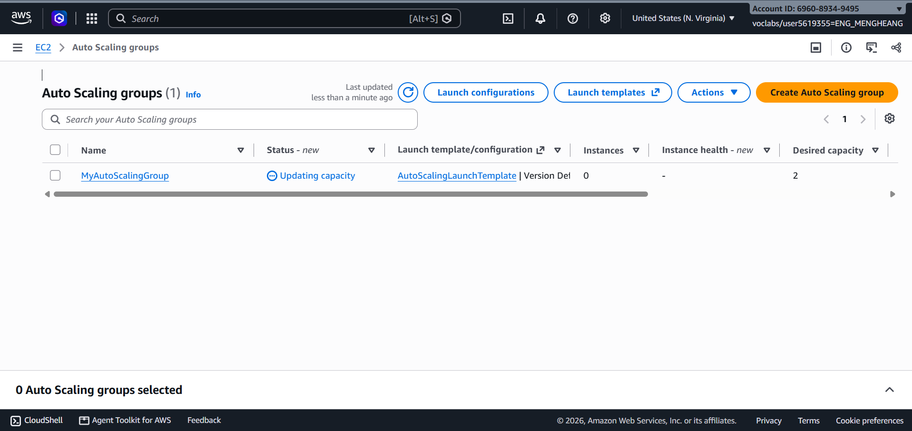

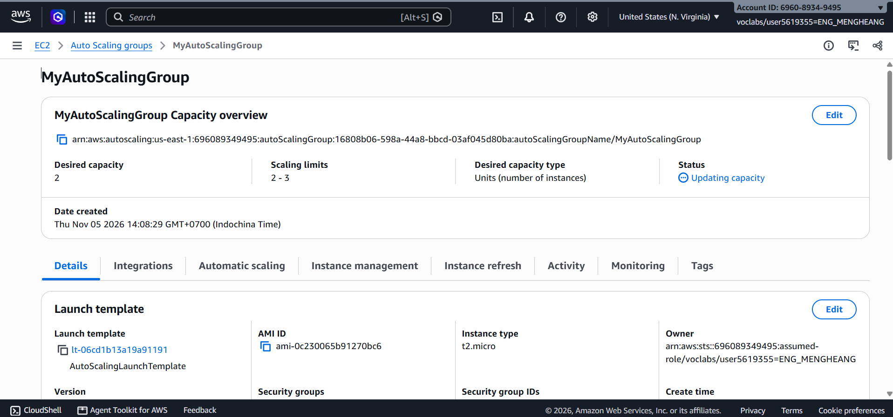

## Load balancing test

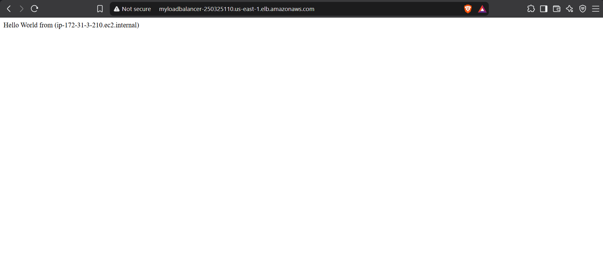

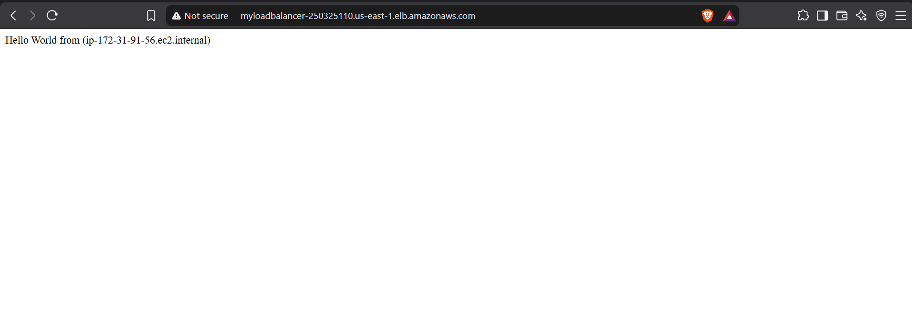

## Simulated application failure

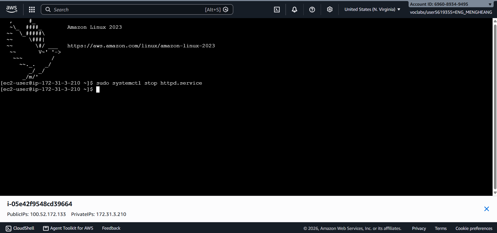

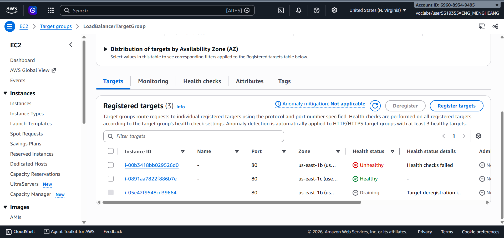

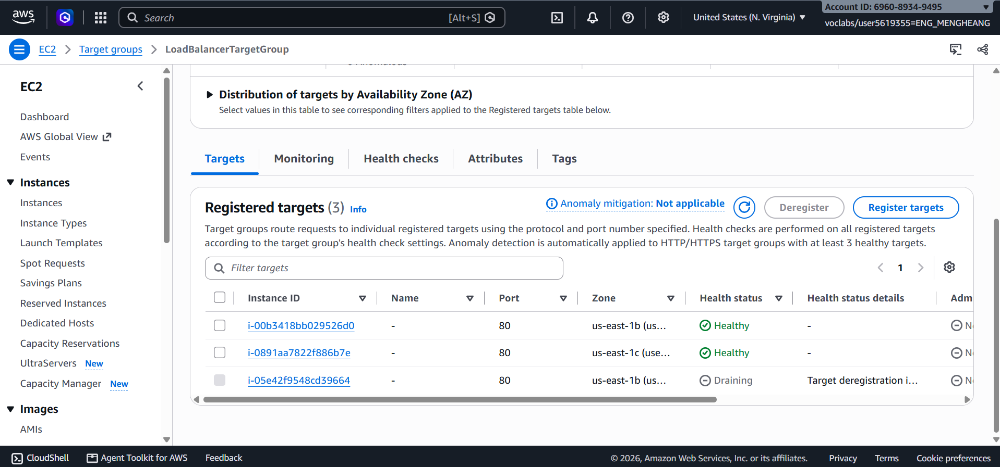

About how many minutes passed between stopping `httpd` and the new instance becoming healthy?

---

## Questions

1. Why does the page show a different host name when you refresh it?
   -> The page shows different host names because the Application Load Balancer sends requests to different healthy EC2 instances. Each instance has its own host name.

2. After you stopped `httpd`, the instance was still _running_ in EC2, but the target group marked it _unhealthy_. What did the health check test, and why did the instance fail it?
   -> The health check tested the HTTP root path / on port 80. After I stopped httpd, the web server stopped responding, so the health check failed and the target became unhealthy.

3. Who replaced the failed instance: the load balancer, the target group, or the Auto Scaling group? Explain the role of each one.
   -> The Auto Scaling group replaced the failed instance. The target group checks instance health and reports unhealthy targets. The load balancer sends requests to healthy targets. The Auto Scaling group launches a replacement instance.

4. With desired 2, minimum 2 and maximum 3, how many instances run normally? In what situation could there be 3?
   ->Normally, 2 instances run because the desired and minimum capacities are both 2. There can be 3 instances temporarily during a replacement or when the group scales out, up to the maximum capacity of 3.

5. The instances' security group allows HTTP from anywhere. How could you change it so that the instances accept HTTP **only** from the load balancer?
   ->Change the inbound HTTP rule in LaunchTemplateSecurityGroup. Instead of allowing HTTP from Anywhere-IPv4, set the source to LoadBalancerSecurityGroup. This allows only the load balancer to access the instances through HTTP.

## Problems and how I solved them (optional)

No major problems occurred during this lab. I followed the AWS instructions and checked the target health status while testing the load balancer and Auto Scaling group.

## AI note (optional)

One suggestion an AI tool gave you and how you checked it.

## Clean up

- [ Done ] `MyAutoScalingGroup` deleted and its instances terminated.
- [ Done ] `AutoScalingLaunchTemplate` deleted.
- [ Done ] `MyLoadBalancer` and `LoadBalancerTargetGroup` deleted.
- [ Done ] Both security groups deleted.
